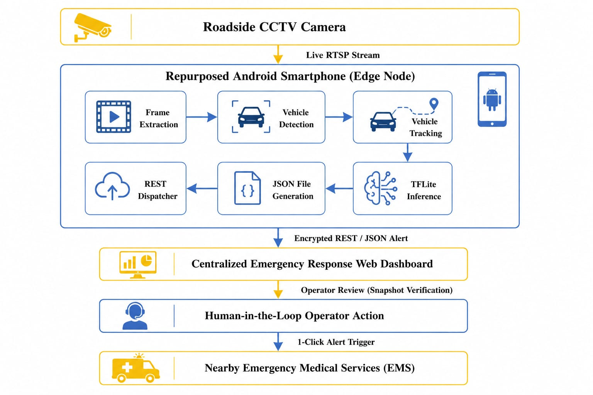
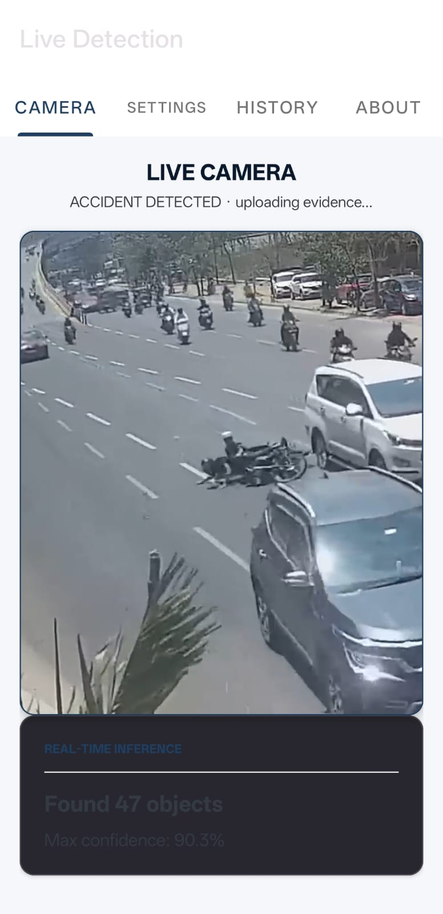
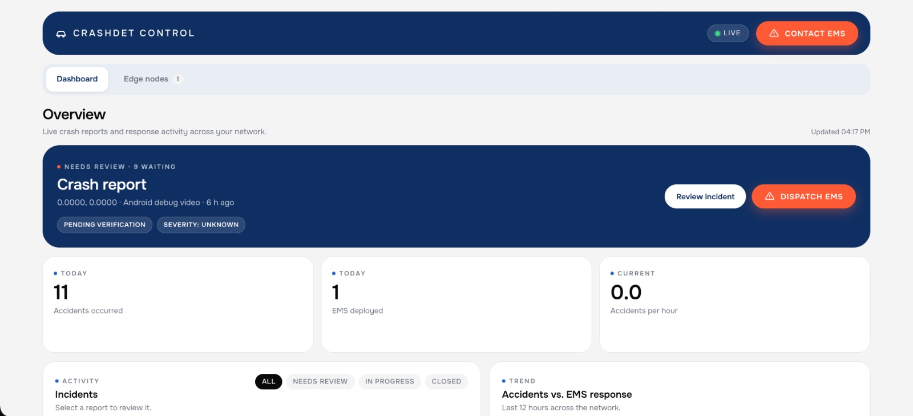
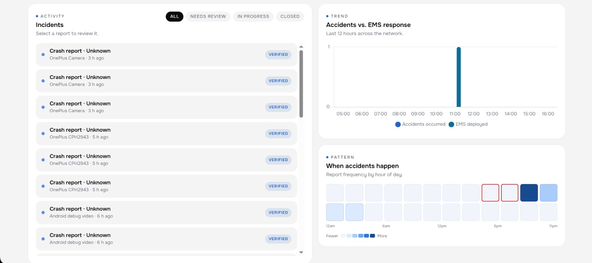
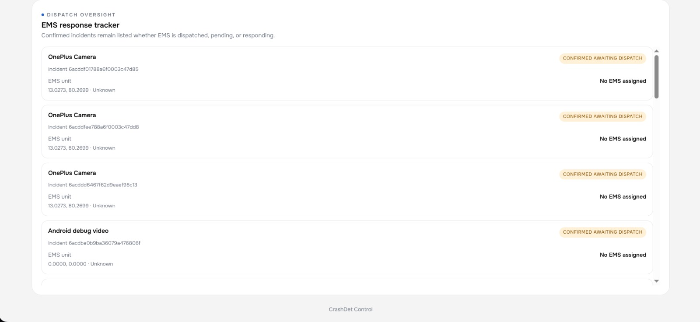
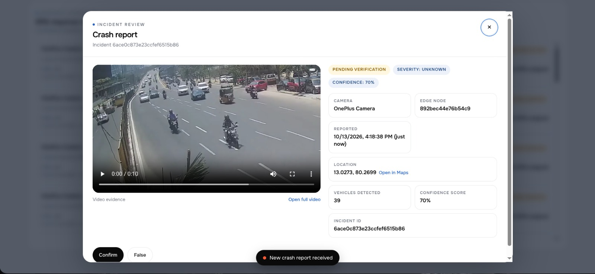

# Crash Detection Using Android Phones

A comprehensive crash detection system leveraging Android smartphone sensors to detect vehicle collisions and provide real-time monitoring through a web dashboard.

## Project Overview
This project comprises two main components:
1.  **Android App**: A sensor-driven application that monitors vehicle dynamics (motion, tracking, and collision logic) to detect potential crashes.
2.  **Web Dashboard**: A real-time monitoring interface that receives data from the Android app, providing alerts and visualization of the vehicle's status.

## System Architecture

*The current version is a proof of concept moving towards a full-scale emergency response integration.*

## Components

### 1. Android Application

The Android app implements a multi-stage crash detection pipeline:
- **Motion Detection**: Monitors accelerometer and gyroscope data to detect high-impact events.
- **Tracking Logic**: Evaluates vehicle movement patterns to filter out false positives.
- **Collision Logic**: Final validation of a crash event before triggering alerts.
- **Real-time Communication**: Uses Socket.io and REST APIs to communicate with the backend.

[View Android App Documentation](./AndroidApp/README.md)

### 2. Web Dashboard & Backend
The backend is built with Express.js and provides:
- **RESTful API**: For data management and client interactions.
- **Real-time Updates**: Server-Sent Events (SSE) for live monitoring of crash status.
- **Security**: Basic authentication and request validation.

[View Dashboard Documentation](./Dashboard/README.md)

## Dashboard Screens

  
  
  
  

## Tech Stack
- **Android**: Java/Kotlin, Android Sensors, Socket.io-client
- **Backend**: Node.js, Express.js, Server-Sent Events (SSE)
- **Frontend**: EJS/HTML, CSS, JavaScript

## Getting Started
To run the project, refer to the individual component READMEs:
- Follow the [Dashboard Setup](./Dashboard/README.md#getting-started) for the backend.
- Follow the [Android App Setup](./AndroidApp/README.md#getting-started) for the mobile client.

## Current Status
- **Version**: 0.1 (Proof of Concept)
- **Status**: Core crash detection pipeline implemented; real-time dashboard functional.
- **Next Steps**: Enhance detection algorithms, integrate Google Maps for location tracking, and implement automated emergency SMS/call notifications.
